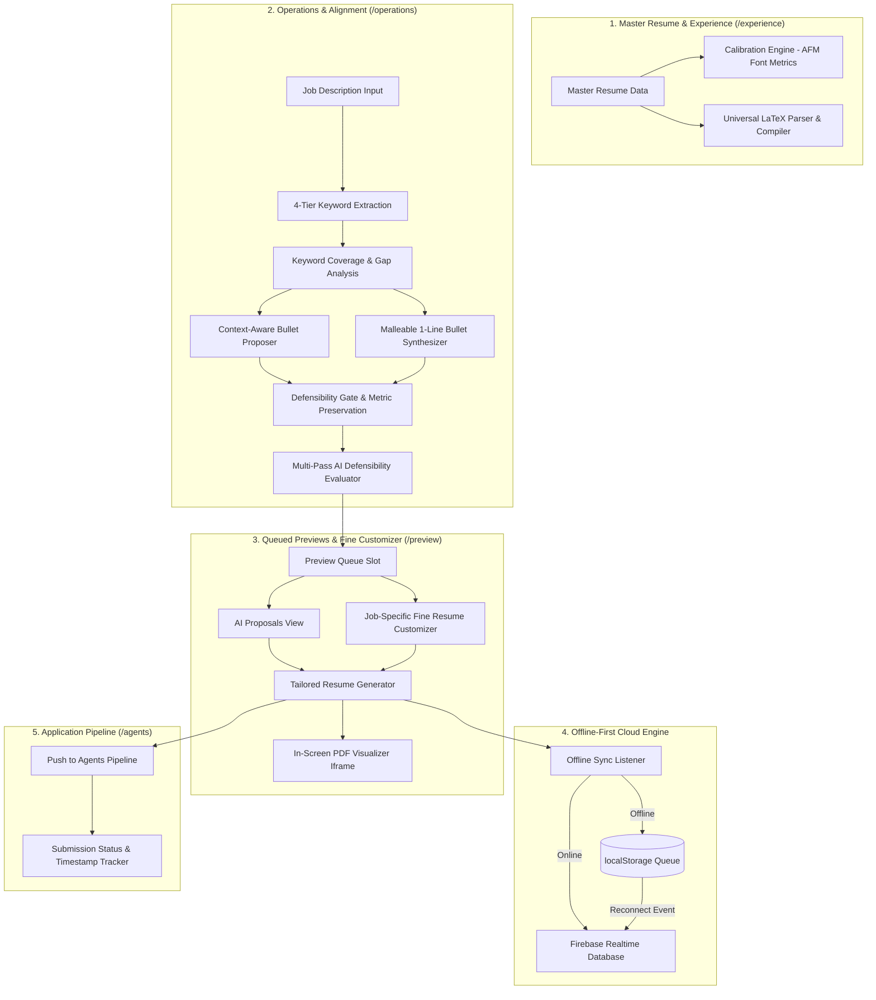

# HireMe

A high-performance, full-stack recruitment, precision resume alignment, and talent discovery platform built for speed, density, and zero cognitive friction. Inspired by the minimalist engineering design systems of Linear, Vercel, and Supabase, **HireMe** connects candidates with opportunities through mathematically calibrated line fits, context-aware resume alignment, on-screen vector PDF visualization, and an offline-first real-time cloud sync engine.

> [!NOTE]
> **Active Development Status:** HireMe is **currently under active development**. Features, UI components, calibration engines, and pipeline integrations are evolving rapidly. Expect continuous improvements, real-time sync enhancements, and new automated submission workflows.

> [!IMPORTANT]
> **Zero Falsification Guardrail:** HireMe enforces strict 4-tier defensibility gates. High-risk claims, unfamiliar low-level languages (e.g. C++, CUDA), and out-of-domain tools are blocked by automated guardrails to ensure 100% realistic interview defensibility.

---

## Table of Contents

- [About HireMe](#about-hireme)
- [Repository & Links](#repository--links)
- [Complete System Architecture & How It Works](#complete-system-architecture--how-it-works)
  - [High-Level Architecture Diagram](#high-level-architecture-diagram)
  - [Pipeline 1: Master Resume & Typographic Calibration Engine](#pipeline-1-master-resume--typographic-calibration-engine)
  - [Pipeline 2: 4-Tier Job Description Analysis & Keyword Extraction](#pipeline-2-4-tier-job-description-analysis--keyword-extraction)
  - [Pipeline 3: Context-Aware Minimal Bullet Reframing](#pipeline-3-context-aware-minimal-bullet-reframing)
  - [Pipeline 4: Malleable 1-Line Bullet Synthesizer (Collapsible)](#pipeline-4-malleable-1-line-bullet-synthesizer-collapsible)
  - [Pipeline 5: Multi-Pass AI Defensibility & Verification Engine](#pipeline-5-multi-pass-ai-defensibility--verification-engine)
  - [Pipeline 6: Queued Previews & In-Browser Vector PDF Visualizer](#pipeline-6-queued-previews--in-browser-vector-pdf-visualizer)
  - [Pipeline 7: Job-Specific Fine Resume Customizer](#pipeline-7-job-specific-fine-resume-customizer)
  - [Pipeline 8: Offline-First Hybrid Cloud Synchronization Engine](#pipeline-8-offline-first-hybrid-cloud-synchronization-engine)
- [Key Features](#key-features)
- [Core Workflows & App Routes](#core-workflows--app-routes)
  - [Master Experience (`/experience`)](#master-experience-experience)
  - [Precision Operations & Role Alignment (`/operations`)](#precision-operations--role-alignment-operations)
  - [Slot Preview & Live PDF Visualizer (`/preview`)](#slot-preview--live-pdf-visualizer-preview)
  - [Agents & Submission Tracker (`/agents`)](#agents--submission-tracker-agents)
- [Minimalist Design System Standards](#minimalist-design-system-standards)
- [Database Schema & Security Model](#database-schema--security-model)
- [Getting Started & Installation](#getting-started--installation)
  - [Prerequisites](#prerequisites)
  - [Environment Setup](#environment-setup)
  - [Local Development](#local-development)
  - [Production Build & Verification](#production-build--verification)
  - [Running Unit & Invariant Tests](#running-unit--invariant-tests)
- [Deployment](#deployment)
- [License](#license)

---

## About HireMe

Modern hiring workflows suffer from high cognitive friction: candidates juggle dozens of resume variants across word processors, battle awkward line-wrap overflows that push single lines onto accidental second pages, and waste hours manually adapting bullet points to match job descriptions.

**HireMe** re-engineers this entire process from first principles:

1. **Single Source of Truth**: Maintain one comprehensive master resume with all experiences, projects, awards, and technical skills.
2. **Mathematical Line Calibration**: Calibrate bullet character budgets and font metrics so resumes fit cleanly on a single publication-grade page without orphan words or overflow pages.
3. **Precision Role Alignment**: Extract target technologies and workflow patterns from any job posting, then reframe existing bullet points with minimal word edits (1–5 words) while preserving 90%+ authentic work.
4. **Collapsible Malleable Bullets**: Generate multi-role 1-line bullet points tailored to target tech stacks with instant collapsible phrasing cards.
5. **Job-Specific Fine Tuning**: Customize any section (experience, projects, skills, contact, education, awards) specifically for an individual application on the preview page without altering your master resume.
6. **Zero-Latency In-Browser PDF Visualizer**: Render true vector PDF previews directly in the browser iframe without downloading files to disk.
7. **Offline-First Cloud Sync**: Work offline seamlessly on planes or trains; mutations buffer locally and automatically flush to Firebase upon reconnection.

---

## Repository & Links

- **GitHub Repository**: [https://github.com/LaxExe/HireMe](https://github.com/LaxExe/HireMe)
- **Issue Tracker**: [https://github.com/LaxExe/HireMe/issues](https://github.com/LaxExe/HireMe/issues)
- **Pull Requests**: [https://github.com/LaxExe/HireMe/pulls](https://github.com/LaxExe/HireMe/pulls)
- **Deployment Platform**: Vercel (Edge Network, Fluid Compute, Production CI/CD)

---

## Complete System Architecture & How It Works

### High-Level Architecture Diagram



---

### Pipeline 1: Master Resume & Typographic Calibration Engine

The core foundation is a typed master resume data structure storing contact info, target role, education, skills, experience bullets, projects, and awards:

- **AFM Helvetica Font-Metric Measurement**: Evaluates character widths and line fills using actual font glyph metrics (scaled to 108 units per line).
- **Line-Budget Calibration**: Enforces strict boundaries (e.g., 108 characters max for 1-line bullets, 216 characters max for 2-line bullets) to prevent awkward orphan wraps that waste vertical page real estate.
- **Universal LaTeX Generation**: Compiles structured resume JSON into modern, publication-grade LaTeX templates with clean line-spread settings and precision margins.

---

### Pipeline 2: 4-Tier Job Description Analysis & Keyword Extraction

When a job description is pasted or scraped from a URL, HireMe runs a multi-tier classification pipeline:

- **Matched**: Skills already present on your master resume.
- **Tier 0 (Workflow & PM Tools)**: Agile, Jira, Linear, Git, CI/CD, Scrum, ticket triage. Safe for centralized, zero-stretch workflow context.
- **Tier 1 (Framing Technologies)**: High-leverage stack tools (e.g., AWS, Docker, Redis, GraphQL, Next.js) that can be framed around existing production code.
- **Tier 1.5 (Skills-Only Additions)**: Secondary tools suitable for adding to skills categories but restricted from bullet injection unless supported by experience.
- **Tier 2 (Banned Guardrails)**: Automatically locks out high-risk technologies (e.g., low-level C++, CUDA, robotics, kernel internals) that would invite dangerous interview overclaims.

---

### Pipeline 3: Context-Aware Minimal Bullet Reframing

Rather than fabricating artificial claims, HireMe performs surgical, minimal rewrites on your genuine bullets:

- **Minimal Word Diff**: Rewrites are restricted to $\le 7$ words changed per bullet (typically 1–5 words).
- **Metric & Number Preservation**: All production numbers, percentages, and performance indicators are locked and strictly preserved.
- **No Double-Counting**: A bullet can be edited by at most one target keyword per run to avoid keyword stuffing.
- **Plausibility Gating**: Rejects incompatible domain pairings (e.g., will never inject Tailwind CSS into an embedded motion-planning bullet).

---

### Pipeline 4: Malleable 1-Line Bullet Synthesizer (Collapsible)

For containers with available line space, HireMe synthesizes calibrated 1-line bullets tailored to target tech stacks:

- **4 Context-Aware Phrasing Styles**:
  1. *Conservative / Core Feature*: Focuses on feature logic, API contracts, and clean architecture.
  2. *Integration & Config*: Focuses on DevOps, containerization, environment configuration, and pipelines.
  3. *Testing & Quality*: Focuses on automated unit/integration testing, assertion coverage, and structured logging.
  4. *Workflow & Ops*: Focuses on cross-functional agile delivery, code reviews, and ticket triage.
- **Collapsible Cards & Batch Controls**: Each synthesized bullet card is fully collapsible with single-line active phrasing previews, section toggles, and **Expand All / Collapse All** controls.

---

### Pipeline 5: Multi-Pass AI Defensibility & Verification Engine

Proposals pass through an automated evaluation and verification pipeline:

- **Defensibility Scoring**: Calculates an additive score based on natural phrasing, line fit, domain plausibility, and interview defensibility.
- **Zero-Banned Verification**: Confirms that zero Tier-2 banned terms exist anywhere in proposed bullet additions.
- **Interview Talking Points**: Generates natural, authentic talking points for every proposed bullet so candidates can confidently discuss them in live interviews.

---

### Pipeline 6: Queued Previews & In-Browser Vector PDF Visualizer

Multiple role applications can be queued simultaneously in the Preview Queue:

- **Zero-Download On-Screen Visualizer**: Embedded PDF iframe compiles and renders the exact vector PDF directly on screen.
- **Live Coverage Summary**: Visualizes before-and-after keyword coverage scores and weighted metrics.
- **Role Queue Sidebar**: Switch between queued applications with a single click; each slot maintains its own isolated modifications.

---

### Pipeline 7: Job-Specific Fine Resume Customizer

A dedicated **Customize Resume** view on the Preview page allows granular editing for a specific job application:

- **All Experience Page Editors Available**: Access `<CalibrationBar />`, `<ContactSection />`, `<EducationSection />`, `<SkillsSection />`, `<ExperienceSection />`, `<ProjectsSection />`, and `<AwardsSection />` right inside Preview.
- **Application Isolation**: All fine customizations modify **only** the active job slot's resume. Your master resume on `/experience` and other queued slots remain completely untouched.
- **Manual Edit Priority**: Editing an experience bullet manually automatically preserves your exact text over AI proposals.
- **Reset to Master**: One-click reset button to discard job-specific overrides and re-sync with your latest master resume.

---

### Pipeline 8: Offline-First Hybrid Cloud Synchronization Engine

HireMe operates an **offline-first hybrid architecture** managed by `src/lib/offlineSync.ts`:

- **Online Mode**: Direct read/write operations to Firebase Realtime Database with live subscriptions across devices.
- **Offline Mode**: When network drops or during travel, mutations buffer in `localStorage` under `hireme_offline_sync_queue`.
- **Automatic Reconnection Flush**: Monitored browser `online` and `focus` events automatically flush queued mutations to Firebase upon reconnection and clear local queues.

---

## Key Features

- **Geist Design System**: Precision minimalist aesthetics inspired by Linear, Vercel, and Supabase.
- **AFM Font Metrics**: Mathematically calibrated character budgets to ensure single-page resume layout.
- **4-Tier Classification**: Matched, Tier 0 (Workflow), Tier 1 (Framing), Tier 1.5 (Skills), Tier 2 (Banned).
- **Collapsible Synthesized Bullets**: Clean expandable cards with one-line previews and batch collapse controls.
- **Job-Specific Fine Editor**: Granular editing of experience, projects, skills, and awards per job application.
- **In-Browser PDF Visualizer**: Live vector rendering without file clutter or manual downloads.
- **Offline-First Sync**: Continuous productivity regardless of internet connectivity.
- **Application Pipeline Tracker**: Transfer tailored resumes to `/agents` and log submissions with timestamps.
- **Zero Telemetry on Export**: Downloaded PDFs and LaTeX sources are completely clean with zero watermarks or internal metadata tags.

---

## Core Workflows & App Routes

| Route | Name | Purpose |
| :--- | :--- | :--- |
| `/` | **Landing Page** | Minimalist overview and quick navigation dock |
| `/experience` | **Master Experience** | Master resume source of truth, section editors, and LaTeX calibration |
| `/operations` | **Precision Operations** | JD keyword extraction, 4-tier classification, and bullet proposals |
| `/preview` | **Preview & Visualizer** | Multi-slot queue, on-screen PDF iframe, and job-specific fine editor |
| `/agents` | **Agents & Pipeline** | Submission tracking, application status logger, and ready-to-send downloads |
| `/login` | **Authentication** | Firebase Authentication session management |

---

## Minimalist Design System Standards

HireMe adheres to strict engineering UI standards:

- **Canvas Background**: `#fafafa` (`bg-[#fafafa]`)
- **Card / Surface**: `#ffffff` (`bg-white`)
- **Subtle Surface**: `#f5f5f5` (`bg-neutral-100`)
- **Dividers & Hairlines**: `1px solid #ebebeb` (`border-[#ebebeb]`)
- **Primary Ink**: `#171717` (`text-neutral-900`)
- **Secondary Ink**: `#525252` (`text-neutral-600`)
- **Typography**: Geist Sans (`font-sans`) for primary UI, Geist Mono (`font-mono`) strictly for dates, timestamps, badge counts, and metrics.
- **Tactility**: Spring tactile feedback (`active:scale-95 transition-all duration-150`).
- **Delicate Shadows Only**: `shadow-2xs` (`0 1px 2px rgba(0, 0, 0, 0.04)`), `shadow-subtle`, `shadow-modal`.
- **Anti-Pattern Compliance**: Zero textual helper hints (e.g., no `(click to toggle)` or `(collapse)` captions). Interface affordance guides the user.

---

## Database Schema & Security Model

```json
{
  "masterResumes": {
    "<uid>": {
      "data": "{...JSON stringified master resume...}",
      "updatedAt": "2026-11-19T10:00:00.000Z"
    }
  },
  "previewQueues": {
    "<uid>": {
      "data": "[...preview slot items with job-specific base resumes...]",
      "updatedAt": "2026-11-19T10:00:00.000Z"
    }
  },
  "agentsQueues": {
    "<uid>": {
      "data": "[...tailored submission entries...]",
      "updatedAt": "2026-11-19T10:00:00.000Z"
    }
  },
  "appliedJobs": {
    "-Oxyz123": {
      "jobTitle": "Senior Full Stack Engineer",
      "jobUrl": "https://company.com/careers/123",
      "status": "applied",
      "timestamp": "2026-11-19T10:00:00.000Z"
    }
  }
}
```

### Security Isolation
- **`masterResumes` / `previewQueues` / `agentsQueues`**: Restricted to authenticated user ownership via `auth.uid === $uid`.
- **`appliedJobs`**: Restricted to administrative oversight.
- **Local Fallbacks**: Safe in-memory and `localStorage` defaults ensure local development and builds never fail when credentials are not yet configured.

---

## Getting Started & Installation

### Prerequisites

- **Node.js**: `18.17+` or `20+`
- **Package Manager**: `npm`, `pnpm`, or `yarn`

### Environment Setup

Create a `.env.local` file in the project root:

```env
# Firebase Configuration
NEXT_PUBLIC_FIREBASE_API_KEY=your_api_key
NEXT_PUBLIC_FIREBASE_AUTH_DOMAIN=your_project.firebaseapp.com
NEXT_PUBLIC_FIREBASE_DATABASE_URL=https://your_project-default-rtdb.firebaseio.com
NEXT_PUBLIC_FIREBASE_PROJECT_ID=your_project_id
NEXT_PUBLIC_FIREBASE_STORAGE_BUCKET=your_project.firebasestorage.app
NEXT_PUBLIC_FIREBASE_MESSAGING_SENDER_ID=your_sender_id
NEXT_PUBLIC_FIREBASE_APP_ID=your_app_id
```

### Local Development

```bash
# 1. Install dependencies
npm install

# 2. Start the development server
npm run dev
```

Open [http://localhost:3000](http://localhost:3000) in your browser.

### Production Build & Verification

```bash
# Run production build and TypeScript check
npm run build
```

### Running Unit & Invariant Tests

```bash
# Execute the comprehensive test suite (61 tests covering snapshot invariants, guardrails, font metrics)
npm test
```

---

## Deployment

HireMe is configured for zero-config deployment on Vercel:

```bash
# Deploy preview build
npx vercel

# Deploy production release
npx vercel --prod
```

Configure environment variables in your Vercel Project Settings or via the Vercel CLI (`vercel env add`).

---

## License

This project is licensed under the MIT License. See [LICENSE](LICENSE) for details.
